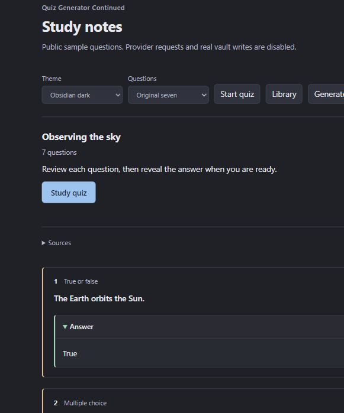

# Quiz Generator Continued

Generate quizzes from your Obsidian notes, save readable questions, and study with timers or flashcards.

[Download the latest release](https://github.com/Abenovv/obsidian-quiz-generator-new-version/releases/latest) · [Release notes](CHANGELOG.md) · [MIT license](LICENSE)

An independently maintained continuation of Edward Cui's [Quiz Generator](https://github.com/ECuiDev/obsidian-quiz-generator). This edition keeps the original plugin ID and adds the study tools described below.

## What changed in 3.1.0

Saved quizzes look like notes again: a question, its context, and a collapsed **Answer**. The structured quiz data stays with the note, so advanced question formats can be reopened without showing a page of JSON.

Existing `quiz-json` blocks render as readable question cards when the plugin is enabled. Use **Make saved quiz readable** on the active note to convert those blocks to native callouts. New callouts remain readable with the plugin disabled.



Preview of the note renderer using public sample questions.

## Install or update

Requires Obsidian 1.7.2 or newer.

1. Download `main.js`, `manifest.json`, and `styles.css` from the [latest release](https://github.com/Abenovv/obsidian-quiz-generator-new-version/releases/latest).
2. Put those three files in `.obsidian/plugins/quiz-generator/` inside your vault.
3. Reload Obsidian, then enable **Quiz Generator Continued** under **Settings → Community plugins**.

When updating, replace only those three files. Keep your local `data.json` and `study-data.json`. The release includes `SHA256SUMS` for checking the downloads.

This continuation shares the `quiz-generator` plugin ID with the original. Install one edition at a time. The automatic source archives contain the development repository; they are not plugin installation packages.

## Start studying

Open **Open study studio** from the command palette or select the plugin's ribbon icon. From the studio, generate questions from notes, import a JSON quiz, create questions, or resume a session.

Configure a provider under **Settings → Quiz Generator Continued → Models** before generating. Available providers are Google Gemini, OpenAI, Anthropic, Mistral, Cohere, Perplexity, and Ollama. Model discovery depends on your provider account; a manual model ID is also supported.

Imported and manually created quizzes do not require an API key. Ollama can generate questions through a local model.

| Mode | Use it for |
| --- | --- |
| Practice | Questions with feedback and explanations. |
| Timed practice | A time limit for the whole quiz or each question. |
| Exam | A timed attempt with answers held until submission. |
| Flashcards | Recall practice with Again, Good, and Easy ratings. |
| Review | Mistakes, skipped questions, and bookmarks. |

The studio keeps your quiz library, session history, and unfinished sessions. Objective questions receive automatic scores. Short and long answers use self-review and do not count toward the automatic score.

## Questions and JSON

The seven original formats remain: true/false, single choice, multiple answers, fill in the blanks, matching, short answer, and long answer.

Ten additional formats cover branching scenarios, sequencing, categorization, error correction, assertion and reason, prediction, evidence selection, answer and justification, concept maps, and what-if questions.

Choose difficulty, topic focus, language, hints, explanations, and source references when generating. Edit individual questions or regenerate one question at a time.

Generation checks the requested question types and counts, removes duplicates and unrequested optional fields, and reports an error if too few valid questions remain. It accepts one complete JSON document from a fenced or narrated response and rejects ambiguous or incomplete output. Answers are not guessed or rewritten during cleanup.

The plugin records the provider, model when available, and generation time once per quiz. These details describe its origin; they do not establish answer accuracy.

Import a question array, a legacy `{ "questions": [...] }` document, or a versioned quiz document. The editor validates a document before saving or exporting. Imports accept up to 500 questions and 2 MiB per document.

Review generated questions before relying on them. Format validation can catch broken data; it cannot establish whether an answer is true.

## Appearance and feedback

Choose **Obsidian**, **Paper**, **Midnight**, or **High contrast**. The study interface adapts to narrow screens and includes keyboard focus indicators.

Under **Study feedback**, turn on **Study sounds** for quiet answer-reveal tones, or use **Test sound** to preview one. Sound is off by default and generated locally. **Motion** can follow your system preference or stay reduced.

## Privacy

Provider keys are stored in your local `data.json`. Quiz history and unfinished sessions are stored in `study-data.json`. Both files are excluded from Git and release assets.

Generating with a hosted model sends the selected note content to the configured provider endpoint. Check your selected notes before generating. Local Ollama use and imported quizzes do not need a hosted provider key.

When reporting a bug, share a small example with private note content and credentials removed. Do not attach your settings or study-history files.

## Development

The 3.1 code is organized into typed modules for note rendering, generation quality, feedback, and integration. The build includes the pinned 3.0.1 runtime to preserve its existing study features.

Use Node.js 24 or newer.

```sh
npm ci
npm run typecheck
npm test
npm run build
npm run verify:release
```

See [architecture and source status](docs/architecture.md) for the compatibility boundary. Earlier upstream source remains in the Git history.

## Credits

Original plugin by **Edward Cui**. This continuation is maintained by **Yerkebulan Abenov** and is not an endorsed release from the original author.

The [MIT license](LICENSE) retains the original copyright notice.
